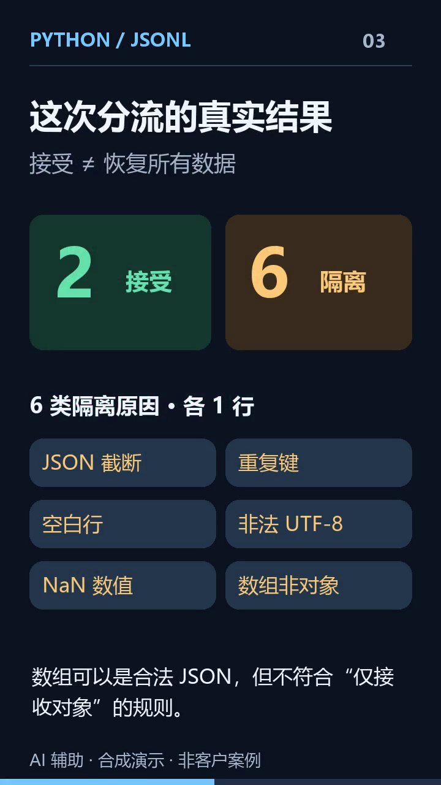

# JSONL 日志清理与坏记录隔离

一个可复现的 Python 数据处理样例：逐行检查日志，把合法 JSON 对象与异常记录分开，同时保留原始字节和每行的处理去向。

这是自建演示，数据为合成样例。代码使用 AI 辅助编写，并经过实际运行验证。它不是客户案例，也不是通用的数据恢复产品。

## 35 秒演示 / 35-second demo

35 秒中文旁白合成演示：8 行输入中，2 行接受、6 行隔离。展示校验、隔离与原件保全，不会恢复全部数据，也不是客户案例。

A 35-second, AI-assisted synthetic demo with Chinese narration: 2 of 8 input lines are accepted and 6 are quarantined. It demonstrates validation, quarantine, and source preservation. It does not recover all data and is not a customer case.



[观看／下载视频 · Watch or download MP4](media/jsonl-demo.mp4) · [查看预览图 · View preview](media/jsonl-preview.png)

## 运行

需要 Python 3.10 或以上版本，仅使用标准库。

```sh
python repair_jsonl.py sample/input.jsonl new-output
python verify_demo.py
```

`new-output` 必须尚不存在。工具不会覆盖已有输出目录。

## 已提供的演示结果

| 输入 | 输出 |
| --- | --- |
| 182 字节、8 个物理行 | 2 条合法对象、6 条隔离记录 |
| 错误 JSON、重复键、损坏 UTF-8、空行、NaN、非对象 | 分别保留原因与原始内容 |
| BOM、CRLF、转义换行、无结尾换行 | 由验证程序覆盖 |

实际输出在 [`result/`](result/)，验证结果在 [`verification.json`](verification.json)。

- `clean.jsonl`：可继续处理的 JSON 对象。
- `rejected.jsonl`：隔离记录、原因及原始字节的 Base64。
- `audit.jsonl`：每行输入的位置、哈希与输出位置。
- `input.original`：本次读取输入的逐字节副本。
- `summary.json`：完成状态、计数与输入哈希。

完整交付应同时满足 `summary.json` 中 `complete` 为 `true`，且没有 `INCOMPLETE.txt`。

## 处理边界

只接受 UTF-8、每行一个 JSON 对象。重复键会被隔离，不会默默覆盖；截断内容不会凭空补齐。

普通小数会经过 Python 浮点解析，**不适用于需要精确保留数值的财务数据**。内存占用取决于最长单行，未做生产规模或巨型单行验证。原始副本和隔离文件应与输入保持同等访问权限。

详细说明见 [`README.txt`](README.txt)。针对具体文件格式、业务字段或现有脚本的问题，需要另行确定复现方式与验收标准。

## English

A small, offline, standard-library Python example for inspecting JSONL logs. Valid
object records are normalized; rejected records retain original bytes, reasons,
line offsets, and hashes. The original input is preserved. No guessed repairs,
network calls, or external packages.

This is a synthetic, AI-assisted demonstration, not a customer engagement.
Run `python verify_demo.py` to reproduce the verification.

MIT License.
